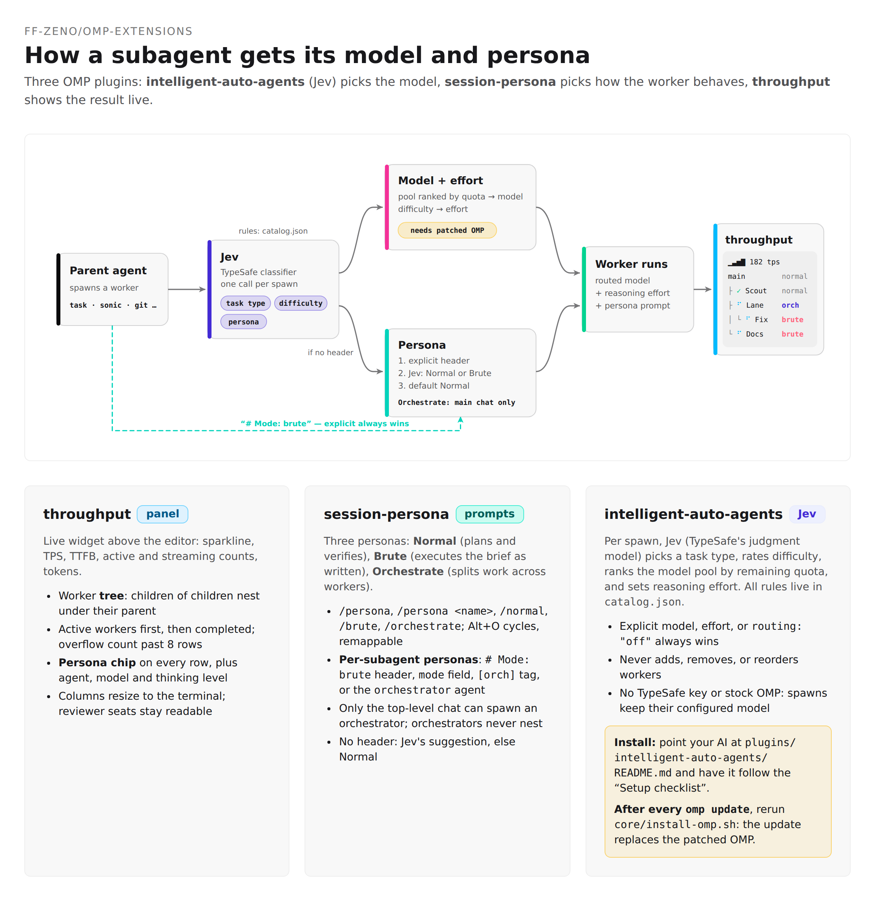

# omp-extensions

Oh My Pi marketplace with three plugins, plus four agent skills for UI work.



| Plugin | What it does | Needs |
|---|---|---|
| `throughput` | TPS sparkline, TTFB, and a tree of worker rows with model, gauge, and token counts. | Stock OMP 18.4.9 or newer |
| `session-persona` | `/persona` or Alt+O cycles the session persona: normal, orchestrate, brute. `/persona <name>`, `/normal`, `/orchestrate`, and `/brute` set one directly. The hotkey is remappable. Subagents inherit a persona from `# Mode:` headers. | Stock OMP 18.4.9 or newer |
| `intelligent-auto-agents` | Subagent router (catalog v9): picks a task type, applies a per-model difficulty-to-effort map, ranks quota-gated pool members per spawn, and suggests a Normal or Brute persona when the parent names none, with a `Directive:` override. Ships `review-frontier-1..3`, `design-master`, `design-second`, `orchestrator`, `plan`, and `git`. | OMP 18.10.4 built with the bundled core patch, and a TypeSafe API key (`/login typesafe`) |

Add the catalog, then install the plugins you want:

```
/marketplace add ff-zeno/omp-extensions
/marketplace install throughput@omp-extensions
/marketplace install session-persona@omp-extensions
/marketplace install intelligent-auto-agents@omp-extensions
```

CLI equivalent:

```
omp plugin marketplace add ff-zeno/omp-extensions
omp plugin install throughput@omp-extensions
omp plugin install session-persona@omp-extensions
omp plugin install intelligent-auto-agents@omp-extensions
```

Restart the session after installing.

`intelligent-auto-agents` disables its routing on stock OMP.
Before installing it, follow the setup checklist in [its README](plugins/intelligent-auto-agents/README.md#setup-checklist): it covers the patched build, the TypeSafe login, the `modelRoles` names to bind, and how to verify each step.
Every `omp update` installs a stock binary, so the patch must be reapplied after each update; [PATCHING.md](plugins/intelligent-auto-agents/core/PATCHING.md) explains the scripted path and the manual rebase.

If `session-mode` is installed, uninstall it before installing `session-persona`.

`cycle/` is a README, not a plugin.
It explains how to set `cycleOrder` and `modelRoles` in `~/.omp/agent/config.yml` so Ctrl+P walks flash → med → slow1 → slow2 → slow3.

## Skills

`skills/` holds plain agent skills (a `SKILL.md` plus references), usable by any agent that loads skill directories.
They keep UI edits on the project's own component kit and tokens instead of ad hoc values.

| Skill | Use it for |
|---|---|
| `ui-consistency` | Any UI edit in a project with a component kit or design tokens. Inventory the kit first, edit with it, then run `scripts/check-drift.mjs` on the diff. The other three skills defer to it. |
| `css-craft` | Layout, overflow, scroll, viewport, form, focus, and mobile CSS bugs with known fixes. |
| `motion` | Deciding whether to animate, building animation, and reviewing or auditing existing motion. |
| `ui-stress` | Breaking a UI with realistic worst-case data, then fixing what breaks. |

Install by symlinking or copying a skill directory into your agent's skills directory, for example `~/.omp/agent/skills/` or `~/.claude/skills/`.
`check-drift.mjs` needs Node 18 or newer, or Bun, and no dependencies.
Each skill's `NOTICE.md` credits the MIT-licensed work it adapts.

## Development

Requirements: Bun (CI uses the latest release), plus `jq` for the manifest check.
The tests mock the `@oh-my-pi/*` imports, so no `bun install` or OMP checkout is needed.

```
bun test plugins/
bash -n plugins/intelligent-auto-agents/core/install-omp.sh
jq empty .omp-plugin/marketplace.json plugins/*/package.json plugins/intelligent-auto-agents/catalog.json
```

CI runs these checks and gitleaks on every push to `main` and every pull request.
Each plugin README has its own install, verify, and uninstall steps; `intelligent-auto-agents` also documents its core patch in [core/PATCHING.md](plugins/intelligent-auto-agents/core/PATCHING.md).
